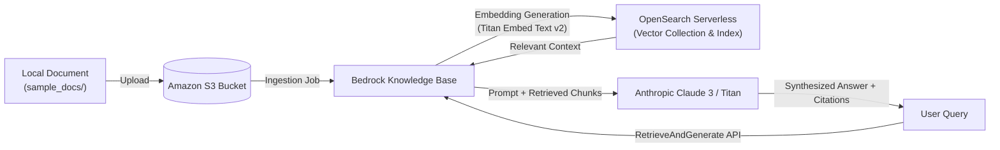

# AWS Bedrock RAG (Console-Free Implementation)

A production-ready implementation of **Retrieval-Augmented Generation (RAG)** using **Amazon Bedrock**, completely built, deployed, queried, and torn down using the **AWS CLI** and **Python SDK (Boto3)** without touching the AWS Web Console.

---

## 🚀 Overview

This repository demonstrates two distinct architectures for building RAG applications on AWS Bedrock:

| Architecture | Description | Infrastructure Required | Cost Profile |
| :--- | :--- | :--- | :--- |
| **Approach 1: Client-Side RAG** (`simple_rag.py`) | In-memory vector search using Bedrock Runtime for embeddings & inference. | None (runs locally) | Pay only per API call / token |
| **Approach 2: Managed Knowledge Base** (`deploy_managed_rag.py`) | Fully automated end-to-end AWS Bedrock Managed Knowledge Base backed by Amazon OpenSearch Serverless. | S3 + IAM + OpenSearch Serverless + Bedrock Agent | Serverless OCU hourly rate |

---

## 🏛️ Architecture (Managed Bedrock Knowledge Base)



### Key Automated Components:
1. **Amazon S3**: Hosts raw document chunks (`docs/nova_spaceworks_handbook.txt`).
2. **IAM Execution Role**: Grants Bedrock least-privilege permissions to read S3, invoke Titan Embedding models, and perform vector operations in OpenSearch.
3. **OpenSearch Serverless (AOSS)**:
   - Automated **Encryption Policy** (AWS-owned key).
   - Automated **Network Policy** (Public collection endpoint).
   - Automated **Data Access Policy** (grants CRUD rights to your IAM identity and Bedrock).
   - Provisions an `ACTIVE` Vector Search collection and creates a 1024-dimension `knn_vector` index (`HNSW/FAISS` with `L2` distance).
4. **Bedrock Knowledge Base & Data Source**:
   - Manages automatic document ingestion, chunking, and embedding.
5. **State Tracking Manifest** (`managed_rag_manifest.json`):
   - Keeps track of all created resource IDs to enable 100% clean teardown.

---

## 📁 Repository Structure

```
├── sample_docs/
│   └── nova_spaceworks_handbook.txt  # Sample technical handbook for indexing
├── deploy_managed_rag.py              # Full automation script: provisions S3, IAM, AOSS, and Bedrock KB
├── query_managed_rag.py               # Interactive CLI to query the Knowledge Base via RetrieveAndGenerate
├── resume_ingestion.py                # Standalone script to start/retry document ingestion
├── teardown_managed_rag.py            # Clean teardown script: deletes all AWS resources
├── simple_rag.py                      # Lightweight in-memory RAG using Bedrock Runtime only
├── requirements.txt                   # Python dependencies (boto3, numpy)
└── .gitignore                         # Ignores manifests, credentials, and virtualenvs
```

---

## 📋 Prerequisites

1. **Python 3.10+**:
   Verify installation:
   ```bash
   python --version
   ```
2. **AWS CLI v2**:
   Configure credentials and default region (`ap-south-1` or `us-east-1`):
   ```bash
   aws configure
   ```
3. **IAM Permissions**:
   Your IAM user/role must have permissions to manage S3, IAM Roles, OpenSearch Serverless, and Bedrock:
   ```json
   {
     "Version": "2012-10-17",
     "Statement": [
       {
         "Effect": "Allow",
         "Action": [
           "s3:*",
           "iam:CreateRole",
           "iam:DeleteRole",
           "iam:PutRolePolicy",
           "iam:DeleteRolePolicy",
           "iam:GetRole",
           "iam:PassRole",
           "aoss:*",
           "bedrock:*"
         ],
         "Resource": "*"
       }
     ]
   }
   ```

---

## ⚡ Quickstart

### 1. Install Dependencies
```bash
pip install -r requirements.txt
```

---

### Option A: Lightweight Client-Side RAG (Instant & Zero Infrastructure)

Runs RAG in memory without provisioning any AWS infrastructure:

```bash
python simple_rag.py
```
- Uses `amazon.titan-embed-text-v2:0` for embeddings.
- Performs cosine similarity matching in Python.
- Uses Bedrock's unified `converse()` API to synthesize the final answer.

---

### Option B: AWS Managed Bedrock Knowledge Base

#### Step 1: Deploy All AWS Infrastructure
```bash
python deploy_managed_rag.py
```
This script will:
- Create an S3 bucket in your region (`ap-south-1`).
- Upload the sample handbook.
- Create an IAM role for Bedrock.
- Provision an OpenSearch Serverless collection and vector index.
- Create the Bedrock Knowledge Base and S3 Data Source.
- Ingest and index the documents.
- Save resource IDs to `managed_rag_manifest.json`.

#### Step 2: Query the Knowledge Base
Run the interactive CLI:
```bash
python query_managed_rag.py
```
Or pass your query directly:
```bash
python query_managed_rag.py "What is the mission objective of Project Nova and when is the launch date?"
```
The output displays the synthesized answer along with exact **S3 citations and matched text chunks**.

#### Step 3: Clean Up All Resources (Crucial for Cost Management)
OpenSearch Serverless charges an hourly rate for active collections (~2 OCUs). When you are done testing, run:

```bash
python teardown_managed_rag.py
```
This cleanly removes:
- S3 Bucket & all uploaded documents
- Bedrock Data Source & Knowledge Base
- OpenSearch Serverless Index & Vector Collection
- OpenSearch Serverless Access, Network, and Encryption Policies
- IAM Role & Inline Policies
- Local deployment manifest

---

## 🛠️ Common Troubleshooting

### 1. `InvalidLocationConstraint` on S3 Bucket Creation
* **Cause**: In AWS S3, `us-east-1` requires omitting `CreateBucketConfiguration`, while all other regions (such as `ap-south-1`) require `CreateBucketConfiguration={'LocationConstraint': region}`.
* **Fix**: The scripts automatically handle this conditional logic based on your configured `REGION`.

### 2. `ThrottlingException: 429 Too many requests` on New AWS Accounts
* **Cause**: On freshly registered AWS accounts or accounts with no prior Bedrock billing history, AWS defaults the on-demand quota for models like `amazon.titan-embed-text-v2:0` to `0.0 Requests Per Minute`.
* **Fix**:
  1. Open a case in the [AWS Support Center](https://console.aws.amazon.com/support/home) under **Account and Billing**.
  2. Request initialization of the starter on-demand quota for Amazon Bedrock in your target region (`ap-south-1`).
  3. Once initialized, run `python resume_ingestion.py` to complete the ingestion job.

---

## 📄 License

MIT License. Free to use and adapt for enterprise or personal RAG implementations.
